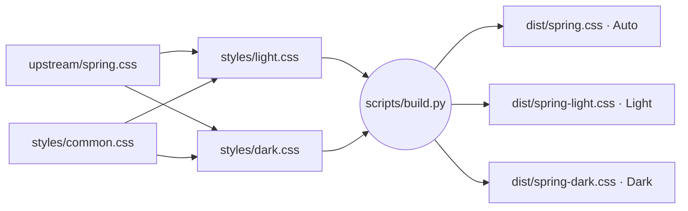
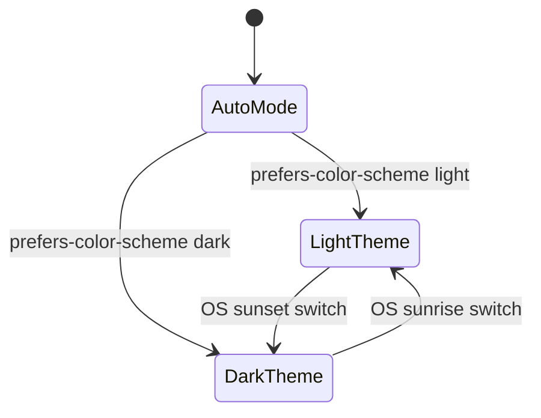
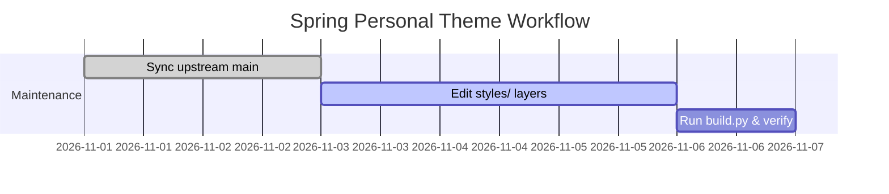

# Spring Theme · 完整样式演示文档 (Demo)

> [!TIP]
> 在 Typora 中安装 [`dist/spring.css`](dist/spring.css)（自动跟随系统）、[`dist/spring-light.css`](dist/spring-light.css)（暖白浅色）或 [`dist/spring-dark.css`](dist/spring-dark.css)（SprIngNight 深色）后，直接打开本文件即可体验所有静态排版与动态交互效果（悬停反馈、专注模式、Ctrl+F 搜索高亮、脚注悬浮窗与滚动条）。

## 目录 · Table of Contents

[TOC]

---

## 1. 六级标题阶梯 · Headings (H1 – H6)

# H1 一级标题 · Primary Document Title
## H2 二级标题 · Section Heading
### H3 三级标题 · Subsection Heading
#### H4 四级标题 · Group Heading
##### H5 五级标题 · Detail Heading
###### H6 六级标题 · Caption Heading

---

## 2. 中英双语正文与行内元素 · Typography & Inline Styles

这是一段用于测试中英文混排与行内样式的正文：**加粗强调（Bold）**、*斜体文字（Italic）*、<u>下划线（Underline）</u>、==荧光高亮（Highlight）==、~~删除线（Strikethrough）~~、`inline_code()`、[超链接样式](https://github.com/Fona1347/typora-spring-theme)、化学与数学上下标 H~2~O / X^2^、快捷键 <kbd>Ctrl</kbd> + <kbd>F</kbd> / <kbd>⌘</kbd> + <kbd>⇧</kbd> + <kbd>P</kbd>，以及 Emoji 🌿 ✨ 🌙。

This paragraph showcases English typography and inline formatting: **bold emphasis**, *italic style*, <u>underlined text</u>, ==highlighted text==, ~~strikethrough~~, `python scripts/build.py`, [GitHub Repository](https://github.com/Fona1347/typora-spring-theme), superscript/subscript E = mc^2^ & CO~2~, keyboard shortcuts <kbd>Ctrl</kbd> + <kbd>Shift</kbd> + <kbd>F</kbd>, and focus/selection legibility.

> **体验提示**：
> - 按下 <kbd>Ctrl</kbd> + <kbd>F</kbd> 搜索 `Spring` 或 `code`，检查普通匹配与当前焦点在加粗、链接和代码块中的高亮对比度。
> - 按下 <kbd>F8</kbd> 开启 **专注模式（Focus Mode）**，拖拽选中任意段落，检查非焦点段落与选中文本的可读性。

---

## 3. IEEE 文献引用与脚注悬浮预览 · IEEE Citations

现代深度学习架构的演进从基于自注意力机制的 Transformer[^1] 到深度残差网络 ResNet[^2]，均体现了高度模块化的结构设计。将鼠标悬停在正文上标 `1` 或 `2` 上，即可预览单层实底的脚注卡片效果（不透出下方正文，文字清晰锐利）。

[^1]: A. Vaswani *et al.*, "Attention Is All You Need," in *Proc. Adv. Neural Inf. Process. Syst. (NeurIPS)*, vol. 30, Long Beach, CA, USA, Dec. 2017, pp. 5998–6008.
[^2]: K. He, X. Zhang, S. Ren, and J. Sun, "Deep Residual Learning for Image Recognition," in *Proc. IEEE Conf. Comput. Vis. Pattern Recognit. (CVPR)*, Las Vegas, NV, USA, Jun. 2016, pp. 770–778, doi: [10.1109/CVPR.2016.90](https://doi.org/10.1109/CVPR.2016.90).

---

## 4. 引用块与五色 GitHub Alerts · Blockquotes & Alerts

### 多级嵌套引用

> 一级引用块：柔和春绿边栏与浅底色，适合长文摘录。
>
> > 二级嵌套引用：边栏与背景逐层加深，清晰区分上下文层次。
> >
> > > 三级深层引用：在浅色暖白与深色炭灰下均保持良好对比度。

### 全部五种 GitHub Alerts

> [!NOTE]
> **NOTE** — 根目录 `spring.css` 保持与上游 `SprInec/typora-spring-theme` 一致，个人定制集中在 `styles/` 目录。

> [!TIP]
> **TIP** — 在 `styles/` 修改完成后，运行构建与浏览器校验：
> - `python scripts/build.py`
> - `python scripts/build.py --check`
> ```bash
> node scripts/verify-browser.mjs
> ```

> [!IMPORTANT]
> **IMPORTANT** — 请只复制 `dist/` 目录下的独立成品 CSS 到 Typora 主题文件夹，无需复制 `styles/` 或根目录 `spring.css`。

> [!WARNING]
> **WARNING** — 深色模式下文档内图片会自动柔和降亮（`brightness(0.9)`），鼠标悬停时恢复原亮度，导出 PDF/打印时不调暗。

> [!CAUTION]
> **CAUTION** — 请勿直接手动编辑 `dist/` 下的生成文件，否则下次执行 `build.py` 时会被覆盖。

---

## 5. 多级混合嵌套列表 · Nested Lists & Tasks

1. 第一阶段：分层主题构建
   - 保留上游基础层 `spring.css`
   - 叠加个人样式层 `styles/common.css`、`light.css`、`dark.css`
     - [x] 暖白浅色纸面配色（`#fffdf8`）
     - [x] 低眩光深色 **SprIngNight**（`#232222`）
     - [ ] 自定义扩展配色方案
2. 第二阶段：阅读体验细节打磨
   1. 修复搜索匹配在格式化文本与代码块中的可见性
   2. 修复引用/脚注悬浮预览半透明叠加问题
   3. 对齐 Typora 原生专注模式与文本选区变量

---

## 6. 三向对齐表格 · Tables

| 成品主题（左对齐） | 外观模式（居中对齐） | 关键配色 / 参数（右对齐） |
| :--- | :---: | ---: |
| `dist/spring.css` | Auto（跟随系统） | `prefers-color-scheme` |
| `dist/spring-light.css` | Light（暖白浅色） | `#fffdf8` / `#282c34` |
| `dist/spring-dark.css` | Dark（SprIngNight） | `#232222` / `#c9c5bc` |

---

## 7. 多语言代码块 · Code Blocks

```javascript
// Layered theme configuration example
export function resolveTheme(mode = "auto") {
  const palettes = {
    light: { bg: "#fffdf8", text: "#282c34", accent: "#2f845e" },
    dark: { bg: "#232222", text: "#c9c5bc", accent: "#91D462" },
  };
  return mode === "dark" ? palettes.dark : palettes.light;
}
```

```python
from pathlib import Path

def list_dist_themes(root: Path) -> list[str]:
    """Return all standalone generated Typora CSS files."""
    return sorted(p.name for p in (root / "dist").glob("*.css"))
```

---

## 8. 数学公式 · Mathematics

行内公式示例：交叉熵损失 $\mathcal{L}(\theta) = -\sum_{i=1}^{N} y_i \log \hat{y}_i$ 与缩放因子 $\sqrt{d_k}$ 可自然融入中英文混排。

块级单行公式（Scaled Dot-Product Attention）：

$$
\text{Attention}(Q, K, V) = \text{softmax}\!\left(\frac{Q K^{\top}}{\sqrt{d_k}}\right) V
$$

多行对齐公式（`aligned`）：

$$
\begin{aligned}
\nabla_{\theta} \mathcal{L}(\theta) &= \mathbb{E}_{(x, y) \sim \mathcal{D}} \left[ \nabla_{\theta} \ell(f_{\theta}(x), y) \right] \\
\theta_{t+1} &= \theta_t - \eta \cdot \frac{\hat{m}_t}{\sqrt{\hat{v}_t} + \epsilon}
\end{aligned}
$$

---

## 9. Mermaid 图表 · Diagrams

### 流程图（Flowchart）



### 状态图（State Diagram）



### 甘特图（Gantt Chart）


