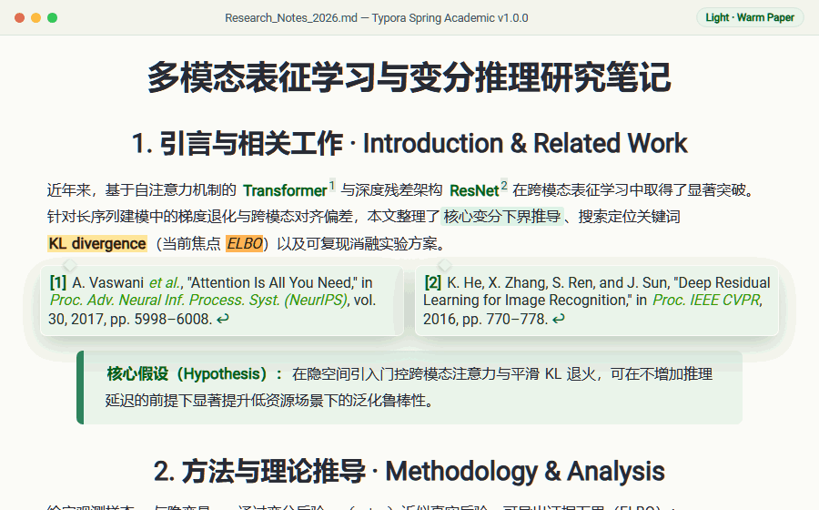
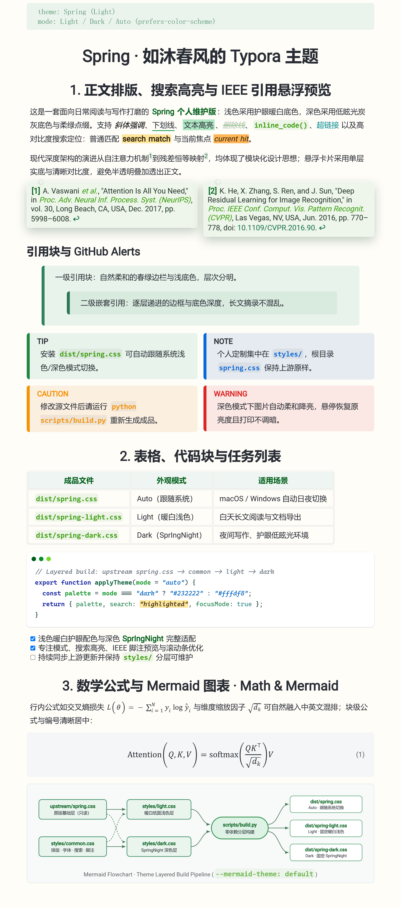
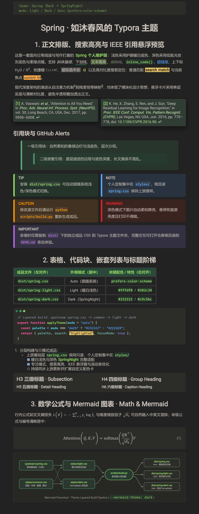
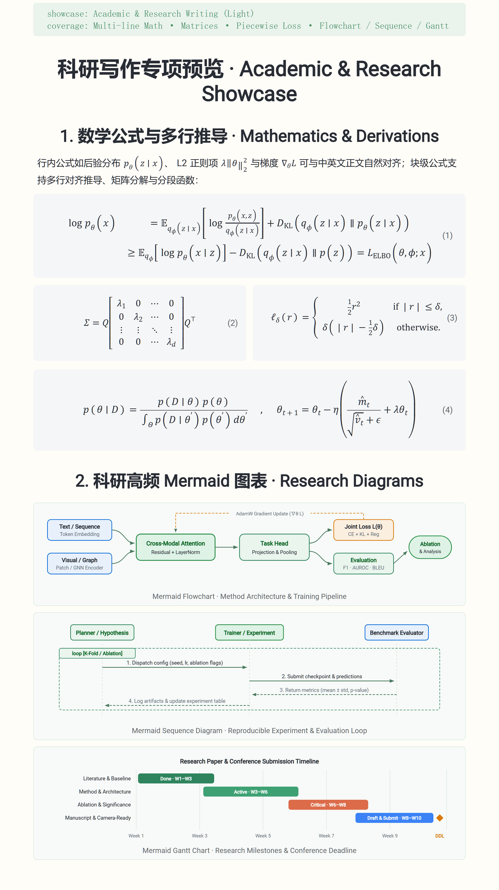
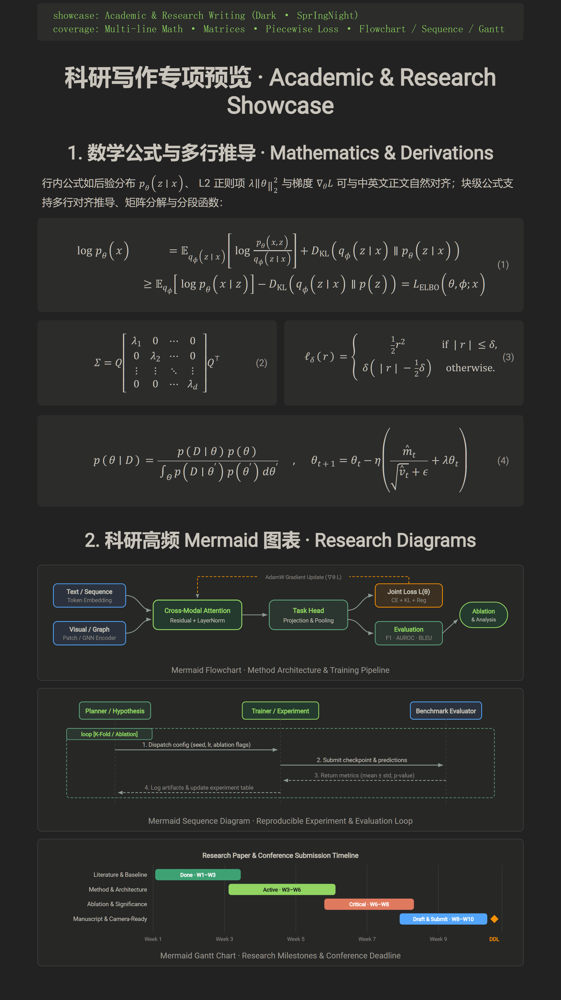

<p align="center">
  
</p>

<h1 align="center">Typora Spring Theme · Light &amp; Dark Edition</h1>

<p align="center">
  A refreshing, readable Typora theme built for <strong>academic writing &amp; research notes</strong>, with full <strong>Light</strong>, <strong>Dark (SprIngNight)</strong>, and <strong>Auto</strong> support.<br/>
  面向<strong>科研写作与硕博日常笔记</strong>打磨的 Typora 主题：内置<strong>暖白浅色</strong>、<strong>SprIngNight 深色</strong>与<strong>跟随系统自动切换</strong>。
</p>

<p align="center">
  <a href="https://github.com/Fona1347/typora-spring-theme/blob/hy-spring/LICENSE"></a>
  <a href="https://github.com/SprInec/typora-spring-theme"></a>
  
  
</p>

<p align="center">
  <strong>English</strong> · <a href="./README_cn.md">简体中文</a> · <a href="./DEMO.md">Interactive Demo (<code>DEMO.md</code>)</a> · <a href="./CUSTOMIZATION.md">Maintenance &amp; Sync Guide</a>
</p>

> **Branch guide:** This fork uses **`hy-spring`** as its default branch. Install the standalone themes directly from [`dist/`](dist/), and edit [`styles/`](styles/) for personal overrides. Root [`spring.css`](spring.css) stays identical to upstream `main` (`SprInec/typora-spring-theme`) for clean upstream syncing.

---

## Installation

### Option A: One-Shot AI Agent Install (Recommended)

Copy and paste the prompt below into your AI coding agent (Claude Code, Cursor, Codex, Antigravity, etc.) to download the latest release, install safely with backups, verify fonts, and return a one-line report:

```text
Install the Typora Spring Academic theme from https://github.com/Fona1347/typora-spring-theme:
1. Detect my OS and locate the Typora themes folder (Windows: %APPDATA%\Typora\themes; macOS: ~/Library/Application Support/abnerworks.Typora/themes; Linux: ~/.config/Typora/themes).
2. Download the latest GitHub Release zip (or fall back to dist/ on the default hy-spring branch), back up any existing spring*.css as .bak, and install spring.css (Auto), spring-light.css (Light), and spring-dark.css (Dark).
3. Verify all 3 CSS files exist and are non-empty without touching other themes, and check whether recommended fonts (Roboto, Noto Sans SC / LXGW WenKai, Fira Code) are installed locally.
4. Reply with a single-sentence summary: install path, installed theme names, any missing recommended fonts, and a reminder to restart Typora.
```

### Option B: Manual Install (Release Zip or Git)

1. **[Download the Latest Release (`v1.0.0`)](https://github.com/Fona1347/typora-spring-theme/releases/latest)** (recommended — includes only the 3 ready-to-use CSS files, `DEMO.md`, and `LICENSE`), or clone this repository (default branch is `hy-spring`):

   ```bash
   git clone https://github.com/Fona1347/typora-spring-theme.git
   ```

2. Open Typora → **Preferences → Appearance → Open Theme Folder**.
3. Copy the theme file(s) you want (`dist/spring.css`, `dist/spring-light.css`, `dist/spring-dark.css`) into the Typora theme folder:
   - `spring.css` — Auto (follows system Light/Dark)
   - `spring-light.css` — Fixed Light
   - `spring-dark.css` — Fixed Dark (SprIngNight)

   > All files in `dist/` (and the Release zip) are self-contained. Do **not** copy `styles/` or the root `spring.css` (which is the unmodified upstream base).
4. Restart Typora, choose **Spring**, **Spring Light**, or **Spring Dark** under **Themes**, and open [`DEMO.md`](DEMO.md) to preview every element live.

---

## Light &amp; Dark Preview

<p align="center">
  
</p>

Both static 2x screenshots below are rendered directly from the generated [`dist/spring-light.css`](dist/spring-light.css) and [`dist/spring-dark.css`](dist/spring-dark.css) themes, showcasing typography, search highlights, IEEE citation hover cards, nested blockquotes, GitHub Alerts, tables, code blocks, task lists, math equations, and Mermaid diagrams.

<table>
  <thead>
    <tr>
      <th width="50%">Light Mode · <code>dist/spring-light.css</code></th>
      <th width="50%">Dark Mode (SprIngNight) · <code>dist/spring-dark.css</code></th>
    </tr>
  </thead>
  <tbody>
    <tr>
      <td><a href=".assets/preview-light.png"></a></td>
      <td><a href=".assets/preview-dark.png"></a></td>
    </tr>
  </tbody>
</table>

### Academic &amp; Research Showcase (Math &amp; Mermaid)

Designed for graduate students and researchers: multi-line `aligned` derivations (ELBO), matrices (`bmatrix`), piecewise losses (`cases`), Bayesian posteriors, and research-grade Mermaid diagrams (Method Flowchart, Experiment Sequence Diagram, and Conference Submission Gantt).

<table>
  <thead>
    <tr>
      <th width="50%">Academic Light · <code>dist/spring-light.css</code></th>
      <th width="50%">Academic Dark · <code>dist/spring-dark.css</code></th>
    </tr>
  </thead>
  <tbody>
    <tr>
      <td><a href=".assets/preview-research-light.png"></a></td>
      <td><a href=".assets/preview-research-dark.png"></a></td>
    </tr>
  </tbody>
</table>

| Area | Light (`spring-light.css`) | Dark (`spring-dark.css`) |
| --- | --- | --- |
| **Canvas &amp; Text** | Warm paper `#fffdf8` · soft ink `#282c34` | Low-glare charcoal `#232222` · warm stone `#c9c5bc` |
| **Accent Palette** | Forest &amp; spring green (`#06621e`, `#2f845e`, `#3ea174`) | Fresh sprout green (`#91D462`, `#5ea67c`, `#3ea174`) |
| **Search Highlights** | High-contrast amber `#ffe69a` / current `#ffb454` | High-contrast gold `#e7c76b` / current `#ffad4d` |
| **Images** | Original brightness | Gentle dimming (`brightness(0.9)`), full brightness on hover &amp; print |
| **UI &amp; Focus Mode** | Matched selection &amp; native focus-mode variables | Full sidebar, source mode, modal, cursor &amp; focus-mode adaptation |

---

## What's Enhanced in This Fork

- **Three Standalone Themes (`dist/`)**:
  - `dist/spring.css` — Automatically follows OS light/dark mode (`prefers-color-scheme`).
  - `dist/spring-light.css` — Always uses the warm-paper light palette.
  - `dist/spring-dark.css` — Always uses the dark **SprIngNight** palette.
- **Layered, Upstream-Friendly Architecture**:
  - Upstream [`spring.css`](spring.css) is never modified directly.
  - Personal layers live in [`styles/common.css`](styles/common.css), [`styles/light.css`](styles/light.css), and [`styles/dark.css`](styles/dark.css), compiled via zero-dependency `python scripts/build.py`.
- **Reading &amp; Editing Refinements**:
  - **Search Highlight Legibility**: `.md-search-hit`, `.md-search-select`, `.cm-searching`, and sidebar matches stay readable over bold, italic, links, and syntax-highlighted code.
  - **Footnote &amp; Citation Hover Previews**: Single-surface opaque card (`opacity: 1`) with crisp typography so underlying body text never bleeds through.
  - **Focus Mode &amp; Selection Alignment**: Typora native `--text-color`, `--blur-text-color`, `--select-text-bg-color`, and `--select-text-font-color` are aligned in both themes.
  - **Print &amp; PDF Export Ready (`@media print`)**: Automatically falls back to a crisp light canvas even when exporting from Dark mode, prevents awkward page breaks across headings/tables/code/equations/Mermaid diagrams, and constrains figure dimensions (`--hy-print-img-max-height: 22cm`, `max-width: 100%`, `object-fit: contain`).
  - **Academic Extras Built-In**: Side-by-side experiment figures (`<div class="img-grid">`), opt-in Booktabs three-line tables (`<div class="booktabs">` or global toggle), opt-in H2–H4 auto-numbering, and a one-line **Calm Mode** (`--use-dynamic-effect: 0`) for distraction-free long manuscripts.
  - **Typography &amp; Layout**: Comfortable `1280px` reading width, balanced heading hierarchy, refined nested blockquotes, five-color GitHub Alerts, and clean scrollbars.

---

## Customization &amp; Layered Build

Edit files in [`styles/`](styles/) rather than `dist/`, then rebuild and verify:

```bash
python scripts/build.py
python scripts/build.py --check
node scripts/verify-browser.mjs
```

- **Calm Mode (zero-jitter long-form writing)**: Uncomment `--use-dynamic-effect: 0;` in `styles/common.css` (`:root`) and rebuild to disable hover motion animations while keeping all colors and typography intact.
- **Booktabs three-line tables &amp; H2–H4 auto-numbering**: Wrap any table in `<div class="booktabs">...</div>` for instant three-line styling, or uncomment the global Booktabs / auto-numbering blocks in `styles/common.css` and rebuild.
- **Side-by-side experiment figures**: Wrap 2–3 `<figure>` or `<p>` image blocks inside `<div class="img-grid">...</div>` (see [`DEMO.md`](DEMO.md)).
- **Typography, width &amp; print image height**: Adjust `--hy-font-ui`, `--hy-font-size`, `--hy-line-height`, `--hy-editor-max-width`, and `--hy-print-img-max-height` in `styles/common.css`.
- **Colors &amp; dark image brightness**: Adjust variables in `styles/light.css` and `styles/dark.css` (`--img-brightness` defaults to `0.9`).
- For full build, verification, and upstream-sync instructions, see [CUSTOMIZATION.md](CUSTOMIZATION.md).

---

## Font Recommendations &amp; Configuration

> **Quick-start pick (minimal setup):** Install just **Roboto** (Latin/numbers) + **Noto Sans SC** or **LXGW WenKai** (Chinese) + **Fira Code** (code) to match the previews out of the box.

The maintained themes use a local-only font stack (no bundled font files, no network requests); code blocks continue to use `Fira Code → Consolas → … → monospace`:

```css
/* styles/common.css */
:root {
    --hy-font-ui: "Roboto", "PingFang SC", "Microsoft YaHei UI", "Noto Sans SC", sans-serif;
}
```

| Font | Suggested Role | License | Official Source |
| --- | --- | --- | --- |
| **Roboto** | Latin body, numbers, and UI | [OFL 1.1](https://github.com/googlefonts/roboto-3-classic/blob/main/OFL.txt) | [Google Fonts](https://fonts.google.com/specimen/Roboto) |
| **Noto Sans SC** | Open-source Simplified Chinese body | [OFL 1.1](https://github.com/google/fonts/blob/main/ofl/notosanssc/OFL.txt) | [Google Fonts](https://fonts.google.com/specimen/Noto+Sans+SC) |
| **Fira Code** | Default monospace code font | [OFL 1.1](https://github.com/tonsky/FiraCode/blob/master/LICENSE) | [GitHub Releases](https://github.com/tonsky/FiraCode/releases) |
| **Cascadia Code** | Code blocks &amp; source mode | [OFL 1.1](https://github.com/microsoft/cascadia-code/blob/main/LICENSE) | [GitHub Releases](https://github.com/microsoft/cascadia-code/releases) |
| **JetBrains Mono** | Alternative monospace code font | [OFL 1.1](https://github.com/JetBrains/JetBrainsMono/blob/master/OFL.txt) | [Official Site](https://www.jetbrains.com/lp/mono/) |
| **Sarasa Mono SC** | Mixed CJK/Latin code &amp; comments | [OFL 1.1](https://github.com/be5invis/Sarasa-Gothic/blob/master/LICENSE) | [GitHub Releases](https://github.com/be5invis/Sarasa-Gothic/releases) |
| **Maple Mono CN** | Monospace with Chinese &amp; NF icons | OFL 1.1 | [GitHub Repo](https://github.com/subframe7536/maple-font#readme) |
| **LXGW WenKai** | Optional calligraphy-style Chinese reading | [OFL 1.1](https://github.com/lxgw/LxgwWenKai/blob/master/OFL.txt) | [GitHub Releases](https://github.com/lxgw/LxgwWenKai/releases) |
| **PingFang SC** | Built-in macOS Chinese UI font | Apple SLA | Bundled with macOS |
| **Microsoft YaHei UI** | Built-in Windows Chinese UI font | Windows License | Bundled with Windows |

---

<details>
<summary><strong>Inherited Upstream Dynamic Interactions (GIF Showcase)</strong></summary>

All original interactive micro-animations from upstream `SprInec/typora-spring-theme` remain available and configurable:

- **Headings (`h1` / `h2` / `h3–h6`)**: subtle hover accents and gradient bars
- **Paragraph &amp; Inline Hover**: responsive highlight feedback on paragraphs, bold, italic, code, and lists
- **Blocks &amp; Tables**: interactive blockquotes, GitHub Alerts, code blocks, tables, and image zoom

<p align="center">
  
  
</p>
<p align="center">
  
  
</p>

</details>

---

## Credits &amp; License

- Original theme created by **[@SprInec](https://github.com/SprInec)** ([SprInec/typora-spring-theme](https://github.com/SprInec/typora-spring-theme)).
- Additional acknowledgments in [credits.md](credits.md).
- Released under the [MIT License](LICENSE).
