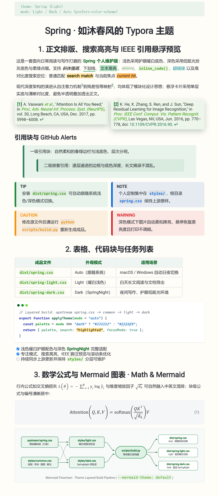
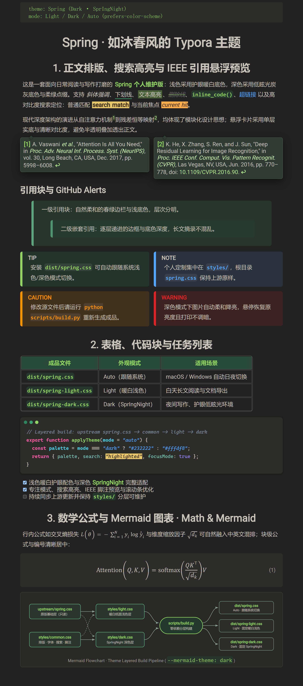

<p align="center">
  
</p>

<h1 align="center">Typora Spring Theme · 浅色 / 深色增强版</h1>

<p align="center">
  一款令人如沐春风的 Typora 灵动主题个人维护版。<br/>
  完整支持 <strong>暖白浅色（Light）</strong>、<strong>SprIngNight 深色（Dark）</strong> 与 <strong>跟随系统自动切换（Auto）</strong>。
</p>

<p align="center">
  <a href="https://github.com/Fona1347/typora-spring-theme/blob/hy-spring/LICENSE"></a>
  <a href="https://github.com/SprInec/typora-spring-theme"></a>
  
  
</p>

<p align="center">
  <a href="./README.md">English</a> · <strong>简体中文</strong> · <a href="./CUSTOMIZATION.md">个人版维护与同步说明</a>
</p>

> **分支说明：** 本仓库默认分支为 **`hy-spring`**。日常使用直接从 [`dist/`](dist/) 安装三款独立成品主题；个性化调整写在 [`styles/`](styles/) 中。根目录 [`spring.css`](spring.css) 与 `main` 分支始终保持上游原样，便于后续同步原作者更新。

---

## 浅色 / 深色实景展示

以下两张预览图均直接由仓库当前的 [`dist/spring-light.css`](dist/spring-light.css) 与 [`dist/spring-dark.css`](dist/spring-dark.css) 真实渲染生成，完整覆盖正文排版、搜索高亮、IEEE 引用悬浮窗、嵌套引用、GitHub Alerts、表格、代码块、任务列表、数学公式与 Mermaid 流程图（点击图片可查看 2x 高清原图）。

<table>
  <thead>
    <tr>
      <th width="50%">浅色模式 · <code>dist/spring-light.css</code></th>
      <th width="50%">深色模式（SprIngNight）· <code>dist/spring-dark.css</code></th>
    </tr>
  </thead>
  <tbody>
    <tr>
      <td><a href=".assets/preview-light.png"></a></td>
      <td><a href=".assets/preview-dark.png"></a></td>
    </tr>
  </tbody>
</table>

| 对比维度 | 浅色版（`spring-light.css`） | 深色版（`spring-dark.css`） |
| --- | --- | --- |
| **背景与正文** | 护眼暖白 `#fffdf8` · 柔和墨灰 `#282c34` | 低眩光炭灰 `#232222` · 暖灰正文 `#c9c5bc` |
| **主题强调色** | 清新森绿（`#06621e` / `#2f845e` / `#3ea174`） | 嫩芽春绿（`#91D462` / `#5ea67c` / `#3ea174`） |
| **搜索匹配高亮** | 琥珀黄 `#ffe69a` / 当前焦点 `#ffb454` | 暖金黄 `#e7c76b` / 当前焦点 `#ffad4d` |
| **图片显示** | 保持原图亮度 | 自动柔和降亮（`brightness(0.9)`），悬停与打印恢复原亮度 |
| **界面与专注模式** | 统一选区与原生专注模式变量 | 完整适配侧边栏、源码模式、弹窗、光标与专注模式 |

---

## 个人版核心升级

- **三款开箱即用的独立成品（`dist/`）**：
  - `dist/spring.css`：自动跟随系统浅色/暗色模式（`prefers-color-scheme`）。
  - `dist/spring-light.css`：始终使用暖白浅色主题。
  - `dist/spring-dark.css`：始终使用暗色 **SprIngNight** 主题。
- **分层维护架构，零冲突同步上游**：
  - 根目录 [`spring.css`](spring.css) 保留上游原文件不直接修改。
  - 个人样式拆分为 [`styles/common.css`](styles/common.css)、[`styles/light.css`](styles/light.css)、[`styles/dark.css`](styles/dark.css) 三层，使用无第三方依赖的 `python scripts/build.py` 一键合成成品，并配有 `node scripts/verify-browser.mjs` 浏览器级样式校验。
- **长文阅读与编辑细节打磨**：
  - **搜索高亮清晰可见**：修复加粗、斜体、链接及代码块语法高亮区域被搜索命中时文字对比度不足的问题（`.md-search-hit` / `.md-search-select` / `.cm-searching` / 侧边栏搜索）。
  - **脚注与引用悬浮预览优化**：改为单层实底卡片（`opacity: 1`）与清晰配色，避免半透明叠加导致下方正文透出干扰阅读。
  - **专注模式与选区对齐**：完整接管 Typora 原生 `--text-color`、`--blur-text-color`、`--select-text-bg-color`、`--select-text-font-color`，深浅色下选中文字均清晰可读。
  - **排版与组件增强**：`1280px` 舒适阅读宽度、多级嵌套引用层次、五色 GitHub Alert 提示块、优雅滚动条与表格视觉微调。

---

## 快速安装与应用

1. 克隆本仓库（默认分支已是 `hy-spring`），或直接在 GitHub 页面下载 ZIP 压缩包：

   ```bash
   git clone https://github.com/Fona1347/typora-spring-theme.git
   ```

2. 打开 Typora，点击左上角 **文件 → 偏好设置 → 外观 → 打开主题文件夹**。
3. 从 `dist/` 目录复制需要使用的主题文件到 Typora 主题文件夹：
   - `dist/spring.css`：自动跟随系统浅色/暗色模式。
   - `dist/spring-light.css`：固定浅色 Spring 主题。
   - `dist/spring-dark.css`：固定暗色 Spring Dark（SprIngNight）主题。

   > `dist/` 下的三个文件均为独立成品，不依赖额外资源；**无需**复制 `styles/` 或根目录的上游 `spring.css`。
4. 重启 Typora，在顶部 **主题** 菜单中选择 **Spring**、**Spring Light** 或 **Spring Dark** 即可。

---

## 自定义配置与分层构建

所有个人修改均在 [`styles/`](styles/) 中进行（不要直接手改 `dist/`），修改后运行构建与校验：

```bash
python scripts/build.py
python scripts/build.py --check
node scripts/verify-browser.mjs
```

- **开关交互动效**：参考根目录 `spring.css` 顶部的变量注释（如 `--use-dynamic-effect`、`--p-hover-effect`、`--table-hover-effect`），在 `styles/common.css` 的 `:root` 中覆写为 `0`（关闭）或 `1`（开启）后重新构建。
- **字号、行高与宽度**：调整 `styles/common.css` 中的 `--hy-font-ui`、`--hy-font-size`、`--hy-line-height`、`--hy-editor-max-width`。
- **配色与深色图片亮度**：调整 `styles/light.css` 和 `styles/dark.css` 中的变量（`--img-brightness` 默认 `0.9`）。
- 完整的构建脚本用法、浏览器检查及上游同步流程见 [个人版维护说明（CUSTOMIZATION.md）](CUSTOMIZATION.md)。

---

## 字体推荐与配置

三款个人主题的正文、标题与界面统一使用本机字体栈（仓库不包含字体文件，也不会联网加载字体）；代码块沿用 `Fira Code → Consolas → … → monospace`：

```css
/* styles/common.css：当前正文与界面字体配置 */
:root {
    --hy-font-ui: "Roboto", "PingFang SC", "Microsoft YaHei UI", "Noto Sans SC", sans-serif;
}
```

| 字体 | 建议用途 | 许可证 | 官方获取入口 |
| --- | --- | --- | --- |
| **Roboto** | 英文正文、数字与界面 | [OFL 1.1](https://github.com/googlefonts/roboto-3-classic/blob/main/OFL.txt) | [Google Fonts](https://fonts.google.com/specimen/Roboto) |
| **Noto Sans SC** | 简体中文正文（跨平台开源组合） | [OFL 1.1](https://github.com/google/fonts/blob/main/ofl/notosanssc/OFL.txt) | [Google Fonts](https://fonts.google.com/specimen/Noto+Sans+SC) |
| **Fira Code** | 基础主题首选代码字体 | [OFL 1.1](https://github.com/tonsky/FiraCode/blob/master/LICENSE) | [官方发行页](https://github.com/tonsky/FiraCode/releases) |
| **Cascadia Code** | 代码块与源码模式 | [OFL 1.1](https://github.com/microsoft/cascadia-code/blob/main/LICENSE) | [官方发行页](https://github.com/microsoft/cascadia-code/releases) |
| **JetBrains Mono** | 代码字体的另一选择 | [OFL 1.1](https://github.com/JetBrains/JetBrainsMono/blob/master/OFL.txt) | [官方网站](https://www.jetbrains.com/lp/mono/) |
| **Sarasa Mono SC（更纱等宽）** | 混合中英文代码与中文注释 | [OFL 1.1](https://github.com/be5invis/Sarasa-Gothic/blob/master/LICENSE) | [官方发行页](https://github.com/be5invis/Sarasa-Gothic/releases) |
| **Maple Mono CN / NF CN** | 带中文字符的等宽代码字体 | OFL 1.1 | [官方项目页](https://github.com/subframe7536/maple-font#readme) |
| **LXGW WenKai（霞鹜文楷）** | 偏手写风格的中文长文阅读 | [OFL 1.1](https://github.com/lxgw/LxgwWenKai/blob/master/OFL.txt) | [官方发行页](https://github.com/lxgw/LxgwWenKai/releases) |
| **PingFang SC（苹方）** | macOS 中文系统字体 | Apple 系统许可 | 随 macOS 内置 |
| **Microsoft YaHei UI** | Windows 中文系统字体 | Windows 字体许可 | 随 Windows 内置 |

---

<details>
<summary><strong>继承自原版的动态交互展示（点击展开动图）</strong></summary>

本主题完整保留上游 `SprInec/typora-spring-theme` 的灵动交互效果，并支持按需在变量中逐项开关：

<p align="center">
  
  
</p>
<p align="center">
  
  
</p>

</details>

---

## 致谢与许可

- 原版主题作者：**[@SprInec](https://github.com/SprInec)**（[SprInec/typora-spring-theme](https://github.com/SprInec/typora-spring-theme)）。
- 更多致谢见 [credits.md](credits.md)。
- 遵循原仓库 [MIT License](LICENSE) 开源协议。
